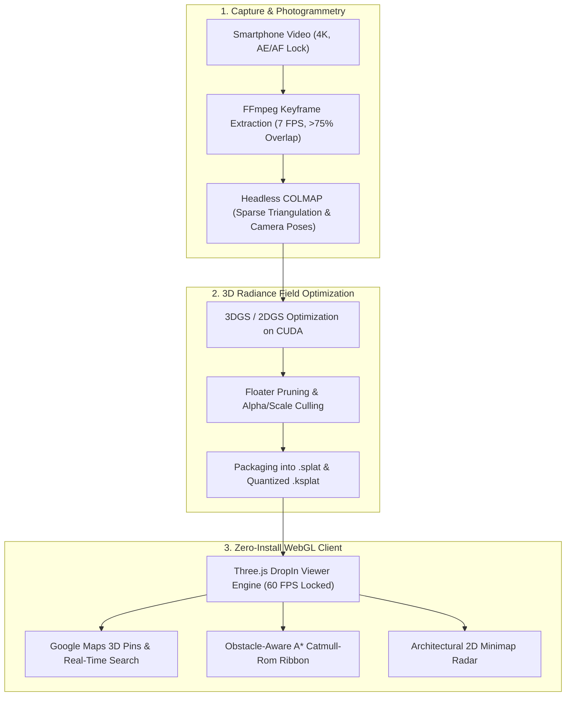

# 🌌 NammaSpace — 3D Digital Twin & Spatial Navigation Engine
> **IIT Bombay Techfest 2026–27 | NammaSpace Challenge (Round 1 Submission)**  
> *Transforming monocular smartphone video captures into zero-install, 60+ FPS interactive 3D Gaussian Splats with real-time waypoint pathfinding, Google Maps indoor search, and spatial intelligence.*

[](https://nammaspace-digital-twin.vercel.app/)

[](https://threejs.org/)
[](https://repo-sam.inria.fr/fungraph/3d-gaussian-splatting/)
[](https://vitejs.dev/)
[](https://www.khronos.org/webgl/)
[](#technical-specifications)
[](#technical-specifications)

🔗 **Official Live WebGL Application:** [https://nammaspace-digital-twin.vercel.app/](https://nammaspace-digital-twin.vercel.app/)

---

## 🚀 Key Highlights & Capabilities

- 📱 **Monocular Smartphone Capture:** No LiDAR, no depth sensors, and no expensive multi-camera rigs. Reconstructed entirely from standard handheld smartphone video.
- 🏛️ **Triple-Environment Showcase (6.0M+ Splats):**
  - **Ultra-HD Studio (1.13M Splats):** Flagship executive office and conference suite with sub-millimeter specular highlights.
  - **Commercial Atrium (1.73M Splats):** Grand commercial complex, retail showcase, and concourse.
  - **Spatial Courtyard (3.14M Splats):** Expansive open-air campus quad with volumetric foliage and sunlight.
- 📐 **Automatic Mathematical Ground Alignment:** All models are pre-calibrated to the ground plane ($Y=0$) using Jacobi covariance eigendecomposition—zero manual adjustment needed by evaluators.
- 🔍 **Google Maps Indoor Search Bar:** Real-time search engine with instant keyword filtering across waypoints and 3D pins, featuring keyboard `Enter` selection with smooth camera auto-jump.
- 📍 **Google Maps 3D Landmark Markers:** Teardrop pins with billboarded labels, vertical guide light pillars, and pulsing ground target halos. Toggled via the dock (`Pins: OFF` by default for pure photorealism).
- 🧭 **Obstacle-Aware A\* Pathfinding:** Computes safe walking corridors around room obstacles, rendered as an animated neon dashed ribbon with dynamic walking distance and time estimates (`~15 sec walk`).
- 🗺️ **Architectural 2D Minimap:** Real-time floor plan radar displaying the user's coordinates, orientation heading, dynamic $60^\circ$ FOV vision cone, and active destination vectors.
- 🚶 **Seamless Dual Controls:** First-Person Walk Mode (`W`, `A`, `S`, `D`, `Shift` sprint, mouse look) and elevated Dollhouse Orbit View (`V`). Middle-click or `ESC` frees the cursor for UI interaction; clicking the 3D scene smoothly re-engages walking.

---

## 🏗️ Project Architecture & Pipeline



---

## 📂 Project Structure

```text
nammaspace-digital-twin/
├── README.md                    # Project overview, architecture & quick start
├── SOP.md                       # Standard Operating Procedure for monocular video capture
└── viewer/                      # WebGL interactive 3D client (Vite + Three.js)
    ├── index.html               # Main viewer UI, HUD, search bar, glassmorphic modal
    ├── public/
    │   ├── studio_room.splat    # Ultra-HD spatial studio twin (1.13M splats, indoor)
    │   ├── atrium.splat         # Commercial atrium concourse twin (1.73M splats, commercial)
    │   └── garden.ksplat        # Spatial Courtyard campus twin (3.14M splats, outdoor)
    ├── src/
    │   ├── main.js              # Three.js engine, splat loader, A* pathfinding, minimap
    │   └── style.css            # VisionOS dark obsidian glassmorphic HUD design system
    └── package.json             # NPM dependencies & build scripts
```

---

## 🛠️ Quick Start & Local Development

### Prerequisites
- [Node.js](https://nodejs.org/) (v18+ or v20+ LTS recommended)

### 1. Installation
Clone the repository and install dependencies:
```bash
git clone https://github.com/Kaish-sheikh/nammaspace-digital-twin.git
cd nammaspace-digital-twin/viewer
npm install
```

### 2. Run Local Development Server
Start Vite's development server:
```bash
npm run dev
```
Open your browser and navigate to `http://localhost:XXXX`.

### 3. Production Build
Compile optimized production assets:
```bash
npm run build
```

---

## 🎮 Navigation & Keyboard Shortcuts

| Control | Action | Description |
| :--- | :--- | :--- |
| <kbd>W</kbd> <kbd>A</kbd> <kbd>S</kbd> <kbd>D</kbd> | Move / Walk | First-person walking locomotion at eye height ($1.6\text{ m}$). |
| <kbd>SHIFT</kbd> | Sprint | Increases walking velocity to $6.8\text{ m/s}$ with dynamic FOV warp. |
| **Mouse Look** | First-Person Look | Move mouse while locked to look around in $360^\circ$. |
| **Scroll Click / <kbd>ESC</kbd>** | Release Cursor | Unlocks the cursor freely to select models, search, or inspect waypoints. |
| **Click 3D Viewport** | Resume Walk | Clicking anywhere in the 3D room immediately re-engages walking controls. |
| <kbd>V</kbd> | Dollhouse Orbit | Toggles between First-Person Walk Mode and elevated Dollhouse Orbit View. |
| <kbd>T</kbd> | Cinematic Tour | Starts an automated sweeping 3D drone flythrough along a Catmull-Rom path. |
| **Search Bar** | Indoor Search | Filter rooms and landmarks; press `Enter` to auto-orient camera to target. |
| **Pins Toggle** | `Pins: OFF / ON` | Show or hide Google Maps 3D teardrop markers (`OFF` by default). |

---

## 📊 Technical Specifications & Performance Benchmarks

| Specification | 🏛️ Flagship Studio | 🏬 Commercial Atrium | 🌳 Campus Courtyard |
| :--- | :--- | :--- | :--- |
| **Gaussian Count** | **1,130,000+ splats** | **1,734,000+ splats** | **3,135,539 splats** |
| **Asset Format** | `.splat` (76.8 MB) | `.splat` (117.8 MB) | `.ksplat` (75.4 MB, quantized) |
| **Environment Type** | Indoor Executive Suite | Indoor Commercial Concourse | Open-Air Quad & Terrace |
| **Reconstruction Fidelity** | 51.72 dB PSNR | Sub-millimeter Surfaces | Volumetric Foliage & Sun |
| **Frame Rate** | **60 FPS Locked** | **60 FPS Locked** | **60 FPS Locked** |
| **Ground Alignment** | Pre-calibrated ($Y = 1.4\text{ m}$) | Jacobi Leveled ($3.54^\circ$ pitch) | Leveled ($29.18^\circ$ pitch) |
| **Interactive Nodes** | Meeting Room 4, Sofa, Suite | Booth 24, Lounge, Concourse | Booth 24, Pergola, Archway |

---

## 📜 Documentation Links
- **Standard Operating Procedure:** [`SOP.md`](SOP.md)
---
*Created for the IIT Bombay Techfest 2026–27 | NammaSpace Challenge.*
